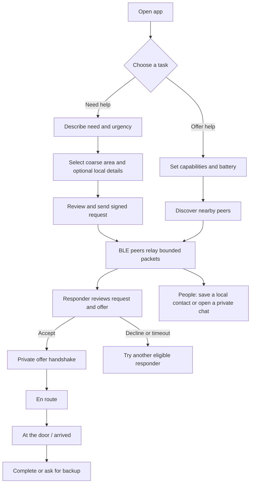
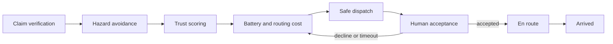

# resQ mesh


An Android app for sending emergency requests and coordinating nearby responders over Bluetooth mesh when internet access is missing. **No server is required for app-to-app mesh use.** This repository also contains an explainer site and a downloadable debug APK.

> **Status:** version 0.2.0 is an early development build. It is not a certified emergency service and has not been field-validated. Do not rely on it as your only means of getting help. BLE range, delivery, routing and battery life vary by device and conditions.

| | |
|---|---|
| Android application ID | `org.cascade.mesh` |
| Version | `0.2.0` (version code 2) |
| Minimum Android | 8.0 / API 26 |
| Language and UI | Kotlin, Jetpack Compose, Material 3 |
| Radio transport | Bluetooth Low Energy, using the Bitchat Android mesh stack |
| App data | Local Room database, encrypted preferences, Android Keystore |
| License | GPL-3.0-or-later; see `LICENSE` and upstream notices |
| Repository | [GitHub](https://github.com/hydra-eng/resq-mesh) |
| Website | [resQ mesh](https://resq-meshnet.web.app) |
| Android download | [Debug APK](https://resq-meshnet.web.app/downloads/resq-mesh-0.2.0-debug.apk) |

## Contents

- [Install and connect two phones](#install-and-connect-two-phones)
- [A normal request flow](#a-normal-request-flow)
- [What the app does](#what-the-app-does)
- [How the mesh works](#how-the-mesh-works)
- [Privacy and security](#privacy-and-security)
- [Build from source](#build-from-source)
- [Project layout](#project-layout)
- [Validation and known limitations](#validation-and-known-limitations)
- [Website and simulator](#website-and-simulator)
- [Contributing](#contributing)

## Install and connect two phones

1. Download the same APK onto both Android phones. The current debug APK is about 75 MiB. Check its SHA-256 before sharing or installing:

   ```text
   3ceb62a4700b5d0e5d30783513d84267729064aadbc6205612a414db6007e356
   ```

2. Install the APK on each phone and open resQ mesh. Android may ask you to allow installation from the browser or file manager used to open the APK.
3. Allow **Nearby devices**. On older Android versions, allow location while using the app; some phones also require the system Location switch to be on for BLE scanning. Notifications allow the foreground mesh service to show its status.
4. On both phones, open **More → Connect** (or the mesh control on Home) and leave the app open while it starts discovery. Keep Bluetooth enabled and the phones nearby. The peer count changes when the other phone is discovered.
5. On one phone choose **Offer help**; on the other choose **Request help**. Use synthetic details for demonstrations. An SOS can be queued before a peer is reachable; the screen does not claim delivery until the transport reports it.

Phones need compatible radios and the app needs to stay permitted to run in the foreground. Manufacturer power management may stop background scanning. Internet is not needed for the app's peer-to-peer mesh, but installation and opening the hosted website require an internet connection. Two phones must have compatible versions and both run resQ mesh.

## A normal request flow



Contact names are stored on the device and are not verified identities. Private chat uses the upstream authenticated Noise session; messages are not sent as public fallback if a secure session is unavailable.

## What the app does

### Main screens and actions

The bottom navigation presents **Home**, **Requests**, **Map**, **People**, and **More**. The interface includes thirteen app destinations: onboarding, home, request creation, incoming request feed, request detail, map, people, one-to-one chat, capability profile, network topology, trust review, hazard reporting, simulation, and settings/help content. Larger layouts can display the people list beside the active conversation.

- **Request help:** record a signed SOS with urgency, a coarse location cell, and structured assistance needs.
- **Offer help:** advertise responder capabilities and current availability for local matching.
- **Requests:** inspect active requests and their dispatch state; delivery is not inferred from local queueing.
- **Map and topology:** show a coarse schematic and locally observed peers, not fabricated turn-by-turn directions or remote battery readings.
- **People and chat:** see nearby nodes and existing conversations, save or rename a local contact, and open a separate conversation. Contact labels do not authenticate someone's identity.
- **Hazards and trust:** record time-bounded observations and review direct peers locally. A single safe report is not enough to certify a cell as safe.
- **Settings:** change theme, radio settings and privacy controls; inspect permission/radio readiness and local-data actions.
- **Accessibility:** large touch targets, system font scaling, TalkBack labels, light/dark themes, reduced-motion handling and explicit status text.

### Feature map

| Need | Behavior |
|---|---|
| Offline coordination | BLE peer discovery, packet forwarding and gossip through the bundled upstream Android mesh infrastructure |
| Structured emergency facts | Signed, bounded, immutable event records and deterministic projections |
| Partition recovery | Merge replicated event sets after peers reconnect; retain arrived responders |
| Responder matching | Stable scoring over urgency, capability, confidence, local trust, coarse distance, hazard and modeled cost |
| Scarce skills | Greedy allocation reserves a uniquely qualified responder for a more urgent eligible case |
| Private health details | Per-offer X25519 exchange, HKDF-SHA256 key derivation and AES-256-GCM encryption |
| Abuse controls | Signature validation, nonce and timestamp replay checks, schema and packet bounds, per-origin and global rate limits |
| Hazard lures | Safe-cell confidence requires independent corroboration; live danger vetoes conflicting safe evidence |
| Individual chat | Separate conversations over an established Noise session, without plaintext broadcast fallback |
| Simulation | Seeded JVM simulator for partitions, conflicting dispatches and attacker traffic |
| Website | Responsive single-file explainer, interactive diagrams, 2D simulator, WebGL fallback and APK checksum display |

## How the mesh works

The Android client builds on [permissionlesstech/bitchat-android](https://github.com/permissionlesstech/bitchat-android), which provides the Kotlin Bluetooth mesh, multi-hop relay, fragmentation, gossip, deduplication, persistent identity and Noise-session implementation. The Apple repository at [permissionlesstech/bitchat](https://github.com/permissionlesstech/bitchat) is a different client; the Android repository is used here because this is an Android application. Existing upstream notices and source are retained. See [`UPSTREAM-README.md`](UPSTREAM-README.md).

The app has no `INTERNET` permission and does not require Firebase or a central server to exchange peer messages. Firebase Hosting serves only the public explainer website and APK download.

### Evaluation pipeline



### Replication and conflict rules

Each operation is a signed fact. Replication merges by set union, so a merge does not depend on packet arrival order. SAFE, CANCEL and COMPLETE events are facts, not deletion of history.

1. An authenticated **ARRIVED** fact is never automatically canceled, including when a competing dispatch is merged.
2. Otherwise, the accepted dispatch with the smallest Lamport clock wins; dispatch ID is the stable tie-break.
3. A responder may explicitly abort or complete. A duplicate that has already arrived remains visible for human resolution.
4. Offers expire for response after 60 seconds; retained signed history can still carry safety facts across reconnection.
5. If disconnected islands accept different assignments, neither can guarantee a global single responder before reconnection. The deterministic merge resolves replicated facts afterward.

The clock provides a shared deterministic logical ordering over the same events; it is not proof of real wall-clock acceptance order. Detailed record types and merge behavior are in [`docs/CASCADE-PROTOCOL.md`](docs/CASCADE-PROTOCOL.md).

### Matching and routing

Every node runs the same fixed-point scoring and stable tie-breaks when given the same candidate and evidence set. The planner filters for eligibility, ranks by urgency/capability/confidence/trust/coarse distance, accounts for hazard and modeled battery/routing cost, and greedily assigns responders. It can reserve a uniquely qualified responder for a higher-urgency nearby case. Nodes can temporarily differ when their radio observations or in-person reviews differ; the app does not claim a coordinator-free consensus on facts that have not propagated.

The map is a coarse-cell schematic. A route is only produced through cells with corroborated safe evidence and known adjacency. It is not GPS turn-by-turn navigation; no report means **unknown**, not safe.

## Privacy and security

- Publicly relayed records are signed and bounded. Relays need routing and matching context, so they can still observe identity, timing, record type, dispatch references and some coarse operational metadata.
- Free-text health details and exact coordinates are encrypted for the selected recipient per offer. The design uses ephemeral X25519 public keys, HKDF-SHA256, and AES-256-GCM with offer/acceptance context bound to the ciphertext.
- Local private data is protected by encrypted app storage backed by Android Keystore. Chat messages and saved contacts remain app-local.
- Nonces, timestamps, signatures, canonical wire encoding, allowlisted schemas, input-size limits, bounded queues and rate budgets mitigate tampering, replay and battery-drain attempts.
- New identities do not earn trust just by arriving in a swarm. Self-asserted medical qualifications are not treated as verified credentials.
- Hazard corroboration requires independent reviewed groups. It helps resist a single false-safe lure; it cannot prove that any route is safe or defeat collusion.
- Location reports can be spoofed, RSSI can be manipulated and peers may collude. These controls raise attack cost; they are not a guarantee against an adaptive adversary.
- Clearing local data cannot erase copies already forwarded to another phone. Do not use real health information in development or demonstrations.

No Firebase SDK, account login, analytics upload or cloud health-data database is configured. Hosting logs are controlled by the hosting provider; the Android app itself exchanges data over nearby radios.

## Build from source

### Requirements

- Android Studio or a full JDK 21 (including `javac` and `jlink`)
- Android SDK platform 37 and Build Tools 37.0.0
- Gradle wrapper downloads Gradle 9.6.1; initial dependency resolution requires internet on the development computer
- Windows: use `gradlew.bat`; macOS/Linux: use `./gradlew`

```sh
./gradlew :app:assembleDebug
```

The universal debug APK is at `app/build/outputs/apk/debug/app-universal-debug.apk`. To run the focused JVM suites and simulator:

```sh
./gradlew :domain:test :pipeline:test :crypto:test :simulator:test
./gradlew :simulator:run --args=100
```

To run the inherited Android unit suite and lint:

```sh
./gradlew :app:testDebugUnitTest :app:lintDebug
```

Known inherited suite/lint findings are documented below; a successful build does not mean all inherited lint findings are resolved.

### Optional release signing

```sh
./gradlew :app:assembleRelease
```

Without signing inputs the release APK is unsigned. To sign a release yourself, set `CASCADE_KEYSTORE`, `CASCADE_STORE_PASSWORD`, `CASCADE_KEY_ALIAS` and `CASCADE_KEY_PASSWORD` in your local environment. Never commit keystores or credentials. This repository does not use the upstream release signing identity.

Dependency lockfiles and Gradle SHA-256 verification metadata are committed. When deliberately changing dependencies, review the updated lock and verification files as part of the change.

## Project layout

| Path | Responsibility |
|---|---|
| `app/src/main/java/com/bitchat/android/mesh` | Upstream Bluetooth mesh integration |
| `app/src/main/java/com/bitchat/android/cascade` | Android adapter, persistence, app actor, permissions and Compose UI |
| `app/src/cascade` | CASCADE Android manifest and resources |
| `domain` | Immutable facts, dispatch records, coarse geohash and grow-only set |
| `pipeline` | Verification, hazards, trust, cost, assignment, explanations and merge resolution |
| `crypto` | Canonical wire format, signatures, encrypted offers, nonce/time and ingress budgets |
| `transport` | Transport contracts shared across the Android adapter and simulator |
| `simulator` | Seeded network, partition and attacker scenarios |
| `docs/CASCADE-PROTOCOL.md` | Protocol, record framing and deterministic reduction |
| `docs/CASCADE-VALIDATION.md` | Automated evidence, synthetic scenarios and physical-device checklist |
| `website/index.html` | Self-contained explainer site (inline CSS/JS; Three.js loaded from pinned CDNJS) |
| `website/downloads` | Versioned APK download and SHA-256 manifest |

## Validation and known limitations

The core JVM suite previously passed 26 focused tests covering event-set laws, dispatch arrival protection, authorization, ranking, opportunity cost, replay, signatures, rate limits, privacy-context binding, hazard corroboration and claim parsing. Three focused Android Bluetooth-readiness regression tests passed. These checks use synthetic data and do not establish field safety.

The earlier inherited full Android suite had 23 failing tests out of 693 (with three skipped), including database-opening and chat/media-delivery assertions. The inherited Android lint run reported 313 errors and 386 warnings, including findings in upstream translation, permission, quantity and messaging code. These remain unresolved; consult [`website/VALIDATION.md`](website/VALIDATION.md) for the UI/browser validation scope and [`docs/CASCADE-VALIDATION.md`](docs/CASCADE-VALIDATION.md) for protocol checks.

The currently hosted APK is a **debug** build. Two physical Android devices are still needed to validate BLE discovery, delivery, private chat, reconnection, background restrictions and power behavior. The simulator measures outcomes in defined synthetic scenarios only; it does not measure real-world attack detection or phone battery consumption. The project is not a replacement for emergency services.

## Website and simulator

Open `website/index.html` locally, or start a static server from the repository:

```sh
node website/serve.cjs
```

The site includes the problem, the five-stage evaluation pipeline, interactive network/flood/Sybil/partition/dispatch scenes, security notes, app-screen gallery, feature grid, 2D simulator, download and installation instructions. It respects reduced-motion settings and has a static fallback when WebGL is unavailable. Three.js is loaded from pinned CDNJS; all page styles and scripts are inline. The app's offline radio operation does not depend on this website.

## Contributing

1. Use synthetic identities, coordinates and health details in issues, logs, demos and test fixtures.
2. Keep the signed fact schema bounded and deterministic. Document changes to authorization, replay, persistence or merge behavior.
3. Add or update focused tests for changes to the deterministic JVM modules.
4. Do not describe model results, RSSI, user claims or BLE presence as verified clinical credentials or guaranteed safety.
5. Test radio behavior on real Android devices before claiming hardware compatibility.

See [the GPL-3.0 license](LICENSE) and the upstream project's retained attribution.
